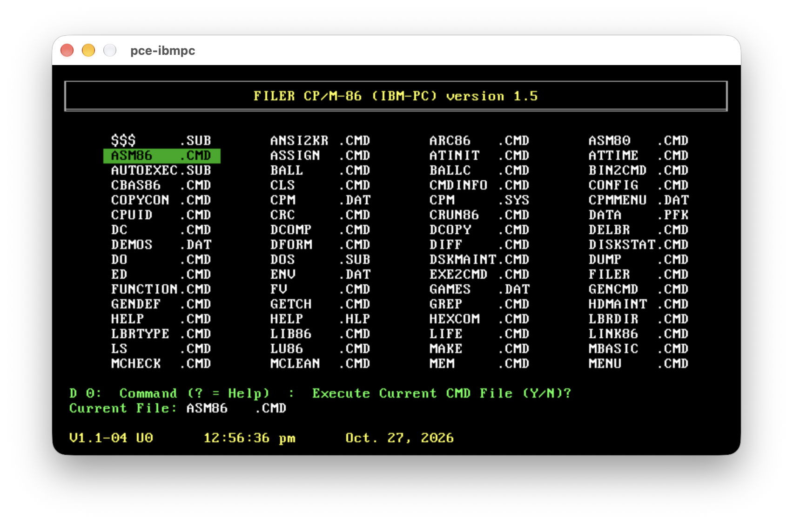
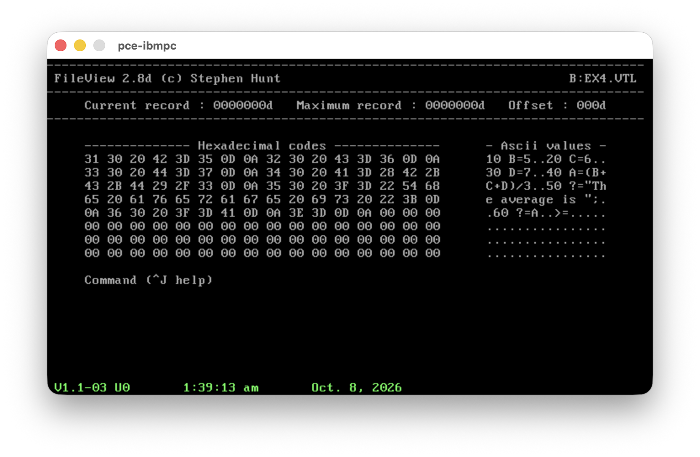
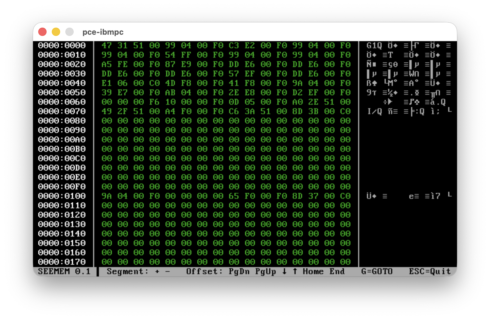
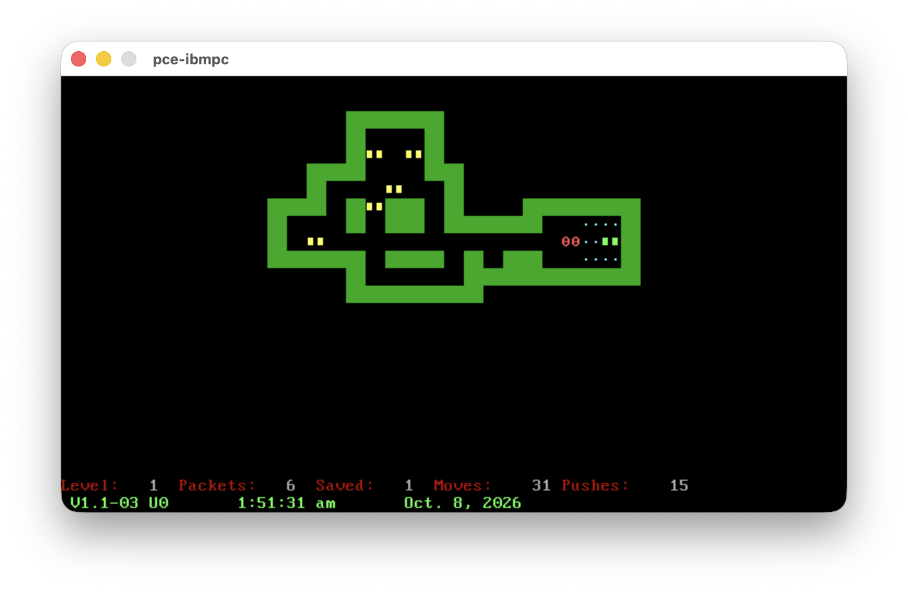
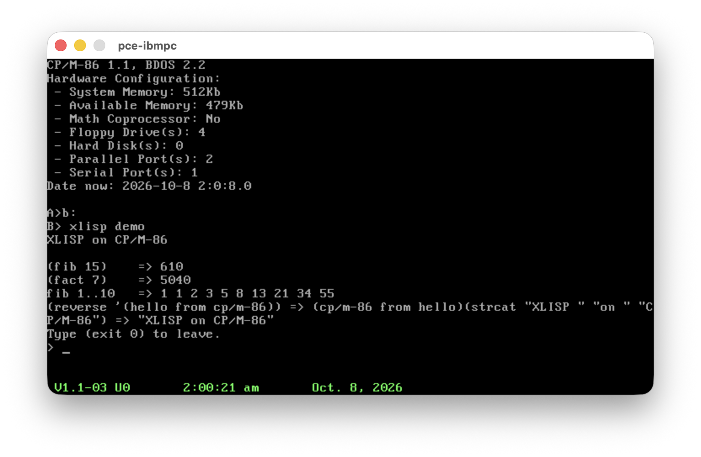
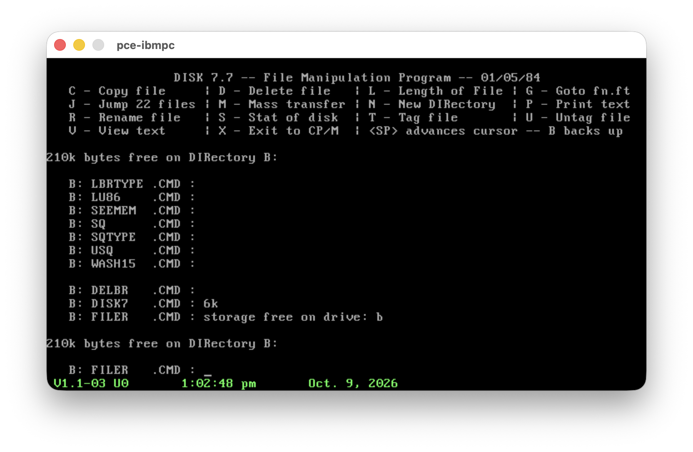

# CP/M-86 Ports

A small collection of classic software tools adapted or ported for CP/M-86 to make this crude CP/M 2.2 usable and keep history tracks of software produced or usable on this old OS. The repository contains language interpreters, compilers, conversion utilities, and other retro-computing experiments assembled for the CP/M environment. All are rebuilt some source, and cleansed, and tested and curated progressively. Here and there the code is corrected/adjusted in a minimal way to keep the original intent. Please do not hesitate to raise issues.

In particular, those tools give a much more friendly user interaction with the old and crude CP/M-86 1.1 that is otherwise reminiscent of CP/M-80 2.2 which is its base.

- file compression
- library management
- disk sweepers
- emulation
- unix like tools
- development tools

Further tools are available from companion projects:
| Category | Tools | Project |
|---|---|---|
| unix like tools | mv, ls, wc, more, touch | [CP/M-86 Hacking Tools](https://github.com/tsupplis/cpm86-hacking) |
| submit tools | pause, cls, wait | [CP/M-86 Hacking Tools](https://github.com/tsupplis/cpm86-hacking) |
| general cli tools | copycon, mem, mode, tod, zpdump, rtc/at time, dump, conio demos | [CP/M-86 Hacking Tools](https://github.com/tsupplis/cpm86-hacking) |
| vi editor | vi | [CP/M-86 VI](https://github.com/tsupplis/cpm86-vi) |
| menus and submit orchestration | menu, msub | [CP/M-86 Menu](https://github.com/tsupplis/cpm86-menu) |
| make build utility | make | [CP/M-86 Make](https://github.com/tsupplis/cpm86-make) |
| microsoft basic | msbasic | [CP/M-86 MS-BASIC](https://github.com/tsupplis/cpm86-msbasic) |
| vedit editor | vedit | [VEDIT Project](https://github.com/johnsonjh/VEDIT) |

Ancillary goals:
- They also expose some practices of CPM/M-80 to CPM/M-86 translation. 
- This project is also used as a soak testing and source for [CP/M-86 Cross Developement Environment] (https://github.com/tsupplis/cpm86-crossdev] ...

<p align="center">


<br><sub>filer (VFILER file manager) &nbsp;·&nbsp; fv (FileView hex/ASCII editor)</sub><br>


<br><sub>seemem (memory browser) &nbsp;·&nbsp; sokoban</sub><br>


<br><sub>xlisp &nbsp;·&nbsp; disk7 (DISK7 full-screen file manager)</sub>
</p>

## Included projects

### Unix-like tools

| Project | What | From | License |
| --- | --- | --- | --- |
| [banner](banner/) | Print large-text banners | RetroBSD / Vadim Antonov, ported by Serge Vakulenko | Public domain |
| [crc](crc/README.md) | Calculate 32-bit CRC checksums | RetroBSD / Gary S. Brown | BSD 3-Clause |
| [dc](dc/README.md) | Arbitrary precision reverse Polish calculator | Plan 9 / Unix Research Edition | MIT |
| [diff](diff/README.md) | Compare two files line by line | RetroBSD / BSD Unix | BSD 3-Clause |
| [grep](grep/README.md) | Search text files for regular-expression matches | RetroBSD / DiscoBSD / Berkeley grep | BSD 3-Clause |
| [sed](sed/README.md) | Edit text using scripts | RetroBSD / BSD Unix | BSD 3-Clause |
| [sort](sort/README.md) | Sort lines, merge sorted files, or check order | BSD Unix / DiscoBSD | BSD 3-Clause |
| [tr](tr/README.md) | Translate, delete, or squeeze characters | BSD Unix / DiscoBSD | BSD 3-Clause |
| [uniq](uniq/README.md) | Filter or count adjacent duplicate lines | BSD Unix / DiscoBSD | BSD 3-Clause |
| [uudecode](uucp/) | Decode a uuencoded file | BSD Unix uudecode | BSD 3-Clause |
| [uuencode](uucp/) | Encode a binary file for mail transfer | BSD Unix uuencode | BSD 3-Clause |


### CP/M-80 culture

| Project | What | From | License |
| --- | --- | --- | --- |
| [disk7](disk7/README.md) | DISK7, a full-screen file manager, translated from CP/M-80 with XLT86 | Frank Gaudé | Non-commercial (© 1984) |
| [diskstat](diskstat/README.md) | DISKSTAT 1.2, display a disk drive's DPB, DPH and usage statistics (used / free blocks), translated from CP/M-80 with XLT86 | D. Powys-Lybbe, MML Systems (1983); 8086 conversion by John Elliott (2015) | Freeware / Abandonware |
| [filer](filer/README.md) | VFILER, a full-screen file manager | ZCPR2 VFILER by Rich Conn, CP/M-86 translation by H. M. Van Tassell | Public domain / Abandonware |
| [fv](fv/README.md) | FileView, view and amend a file in hex and ASCII | Stephen Hunt | Public domain |
| [lbr](lbr/) | LU library (.LBR) tools: lu86 manages libraries; lbrdir lists members, lbrtype displays them, and delbr extracts them | lu86 / Stephen C. Hemminger, Bill Bolton; lbrdir/lbrtype by Charlie Godet-Ceraolo; delbr by Jeff Martin | Public domain / Abandonware |
| [seemem](seemem/README.md) | Full-screen memory browser for CP/M-86 on the IBM PC | Frank Kotler and Kirk Lawrence | Freeware / Public domain |
| [wash15](wash15/README.md) | WASH, a directory maintenance utility, translated from CP/M-80 with XLT86 | Michael J. Karas, Simon J. Ewins | Public domain, non-commercial |
| [xsq](xsq/README.md) | sq, usq and sqtype: squeeze, unsqueeze and display squeezed (.?Q?) files | Richard Greenlaw, with Dick Greenlaw, Chuck Forsberg and W. Earnest | Public domain / Abandonware |
| [kermit](kermit/README.md) (WIP) | Kermit-86 v2.9 file transfer, IBM PC/XT port (COM1/COM2, 8250 UART, interrupt-driven) | Columbia University Kermit-86 v2.9 | Public domain |


### Games

| Project | What | From | License |
| --- | --- | --- | --- |
| [life](life/README.md) | Conway's Game of Life for VT52 terminals, 20×60 grid | Kevin Boone, May 2021 | Public domain |
| [sokoban](sokoban/README.md) | Sokoban puzzle game for VT52 terminals | CP/M-80 C sources | Freeware / Copyright |
| [trek](trek/README.md) | Star Trek, the classic 1970s text-mode strategy game: hunt down the Klingon fleet before the stardate deadline (C port of the BASIC original) | Classic Star Trek BASIC game | Public domain / Abandonware |


### Development tools and interpreters

| Project | What | From | License | Notes |
| --- | --- | --- | --- | --- |
| [ansi2kr](ansi2kr/README.md) | ANSI C to K&R C converter for BDS C and MSX-C | masakioba / upstream ansi2kr sources | BSD 2-Clause | Used by [cpm86-crossdev](https://github.com/tsupplis/cpm86-crossdev) |
| [cpu](cpu/README.md) | CPU tools: 80x86 (8080-to-8086 source translator), vcpm (V20 hardware 8080 emulator), z80 (software 8080 emulator) and cpuid (processor detection) | Harold V. McIntosh; Stephen Hunt; Pat Hester and Bill Earnest; Richard C. Leinecker and Kirk Lawrence | Mixed / Freeware | |
| [ratfor](ratfor/README.md) | RATFOR v1.05 preprocessor — translates structured Fortran to standard Fortran 77; use `-u` for DR Fortran-77 compatible upper-case output | Brian Gaeke / UofA Ratfor C sources | Public domain | Used by [cpm86-crossdev](https://github.com/tsupplis/cpm86-crossdev) |
| [tinybas](tinybas/README.md) | Tiny BASIC interpreter | Classic Tiny BASIC sources | Public domain / Abandonware | |
| [xlisp](xlisp/) | Lisp interpreter and runtime | David Betz | Public domain / Abandonware | |
| [yacc](yacc/) | YACC-compatible parser generator | RetroBSD / original yacc sources | BSD-style | |

### Libraries

| Project | What | From | License |
| --- | --- | --- | --- |
| [ndbm](ndbm/) | Hashed key/value database library (ndbm) with `keydb` CLI tool (add, get, del, list) | 2.11BSD ndbm by UC Berkeley | BSD |

### Archeology

| Project | What | From | License |
| --- | --- | --- | --- |
| [edlin](edlin/README.md) | Edlin line editor port from PC DOS 1.1 | Microsoft sources | MIT |
| [vtl2](vtl2/README.md) | VTL-2 interpreter; regression test for the XLT86 CP/M-80→86 translator | MITS VTL-2 source, adapted for CP/M | Public domain / Abandonware |

## Build notes

The root Makefile builds the subprojects in order:

```sh
make
make test        # available automated suites and build checks; no PCE
make final-test  # manual PCE session with the assembled disk images
make clean
```

Each subdirectory typically contains its own Makefile and CP/M or DOS build artifacts.
`make test` runs the projects listed in `TEST_SUBDIRS`, reports every failed suite,
and returns failure if any fail. Projects without runnable suites are excluded.
Archive round trips, multi-page binary database persistence, and XLISP behavior
are included. Build and packaging errors abort their targets; failed outputs
are removed rather than left as apparently successful releases.
Suites run without a controlling terminal so emulators cannot alter the console.
PCE sessions in `ansi2kr` and `edlin` are available only through `final-test`.

## Cross-development environment

For a CP/M-86 cross-development setup, see:

https://github.com/tsupplis/cpm86-crossdev

## Notes

This repository is mainly a collection of historical software ports and adaptations, not a single monolithic application. Licensing remains mixed because each project keeps its own original upstream terms where applicable.

## Summary

The goal of this collection is to keep small classic programming tools usable in a CP/M-86 environment, while preserving the original source material and the spirit of the original software.

--

## Companion projects

| Project | Description |
|---------|-------------|
| [cpm86-kernel](https://github.com/tsupplis/cpm86-kernel)     | CP/M-86 1.1 distribution rebuilt from patched and reconstituted sources |
| [ccpm86-kernel](https://github.com/tsupplis/ccpm86-kernel)         | CCP/M-86 3.1 distribution rebuilt from patched and reconstituted sources |
| [cpm86-crossdev](https://github.com/tsupplis/cpm86-crossdev) | Unix CP/M-86 cross development project (compilers, emulation and tools) |
| [cpm86-hacking](https://github.com/tsupplis/cpm86-hacking)   | CP/M-86 miscellaneous tools and PCE emulator helpers |
| [cpm86-cmdtools](https://github.com/tsupplis/cpm86-cmdtools) | CP/M-86 `.cmd` file manipulation tools |
| [cpm86-ports](https://github.com/tsupplis/cpm86-ports)       | CP/M-86 application ports in C and assembler |
| [cpm86-vi](https://github.com/tsupplis/cpm86-vi)             | STevie vi port for CP/M-86 and PC-DOS 1.1 |
| [cpm86-msbasic](https://github.com/tsupplis/cpm86-msbasic)   | A recreaction of msbasic-86 for CP/M-86 and PC-DOS 1.1 from gwbasic sources |
| [cpm86-menu](https://github.com/tsupplis/cpm86-menu)   | A submit replacement and a menu system for submit orchestration for CP/M-86 |
| [cpm86-make](https://github.com/tsupplis/cpm86-make)   | A simple submit based make tool for CP/M-86 |
| [pcdos11-hacking](https://github.com/tsupplis/pcdos11-hacking) | PC-DOS 1.1 distribution, tools and notes |

--

## License

The whole repository is as public domain. [License](LICENSE.md) unless specified otherwise in a subdirectory.

