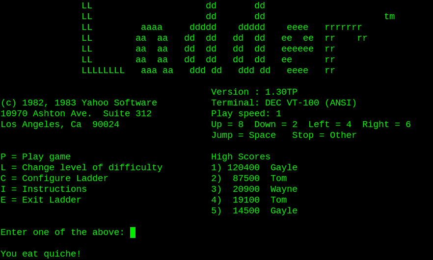
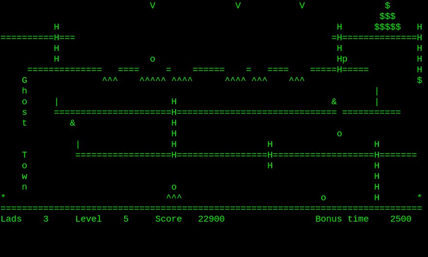

# Ladder
The classic CP/M game Ladder reverse engineered in Turbo Pascal.

#### This is a rewrite in Turbo Pascal of the classic CP/M game "Ladder", originally written by Yahoo Software (not Yahoo!).

Ladder is an ASCII character based platform arcade game similar to 
Donkey Kong. You travel through levels with platforms and ladders 
where rocks fall down from the top while you collect statues 
before reaching the exit.

Back in 1999 Stephen Ostermiller made a version of [Ladder in 
Java](http://ostermiller.org/ladder/). Later, Mats Engstrom of 
SmallRoomLabs started another version in of [Ladder in 
golang](https://github.com/SmallRoomLabs/ladder). Between my own 
memories of playing the original game on a Kaypro, and Stephen 
Ostermiller's and Mats Engstrom's code, I was able to come up 
with this version.

## Build and run

Run `make` in this directory with the cross-development tools on your path.
The build uses `cpm86_tp3` and produces `ladder.cmd` for IBM PC CP/M-86 and
CCP/M-86. Copy `LADDER.CMD` and the supplied `LADDER.DAT` into the same drive
and user area, then run `LADDER` there. Keep `LADDER.DAT` writable to save
high scores.

The hero is bright cyan and the opposing rocks are bright red. Ladders,
platforms and walls are bright yellow, as are the menu selection letters
and movement keys.

Press **P** to play, **L** to cycle through the five speeds, or **E** to exit.
The supplied movement keys are **K** left, **L** right, **A** up and **S** down;
**Space** jumps, **Esc** pauses, and **Return** resumes. **Ctrl-C** returns to
the main menu during play.

## Configuration file

`LADDER.DAT` is the original 512-byte binary configuration and high-score
file. This port reads the terminal name for display, movement keys, sound
and insult flags, and high scores. The supplied file names the terminal
`IBM PC`, disables sound and insults, and starts with empty high scores.

Terminal escape sequences stored in the file are ignored: Turbo Pascal
handles screen positioning and clearing, and `ladutils.pas` selects the
native cursor visibility sequences for CP/M-86 or CCP/M-86 automatically.
Playing speed is defined in `ladicons.pas`, not read from `LADDER.DAT`.

To change the supplied settings with a binary editor, preserve the file's
512-byte layout:

| Offset (hex) | Setting | Values |
| --- | --- | --- |
| `C0` | Sound | ASCII `Y` or `N` |
| `C1` | Insults | ASCII `Y` or `N` |
| `E0`–`E3` | Down, left, right, up | Four uppercase ASCII keys; default `SKLA` |

The bundled `LADCONF.COM` is the legacy CP/M-80 configuration program;
this build does not provide a native CP/M-86 configurator. The **C** menu
option and missing-file path still attempt to launch it, so use the supplied
`LADDER.DAT` rather than relying on automatic configuration on CP/M-86.

## Limitations

At the moment, once you've successfully completed the 7th distinct level 
(Gang Land), the program just cycles through all 7 seven levels over and
over again until the bonus time becomes too short to actually finish a 
level. If anyone knows what the original program actually did (I never 
managed to get anywhere near to completing the original game), let me 
know and I'll see what I can do.

Timing uses the IBM PC BIOS clock through inline assembly in `ladtime.pas`,
independent of Turbo Pascal's CPU-calibrated `Delay`. CP/M-86 waits with
`HLT`; CCP/M-86 yields through BDOS 141. No timer interrupt is replaced.
The bonus countdown advances every three elapsed seconds and freezes while
paused. The five playing speeds use movement intervals of 180, 90, 45, 24 and 13 ms; the approximately 55 ms BIOS
resolution makes faster speeds advance in small batches (at most eight moves
after a stall). Animation delays also use the BIOS clock. Cursor visibility uses the native
CP/M-86 or CCP/M-86 console sequences, selected automatically.

A standalone timing regression is included as `tsttime.pas`. Compile with
`cpm86_tp3 tsttime.pas`, then run `TSTTIME` under CP/M-86 or CCP/M-86 on an
IBM PC (or PCE). It checks tick conversion, signed/word rollover, midnight,
and a one-second wait; success ends with `Timing PASS`. Repeat at different
emulated CPU speeds to check that timing remains independent of CPU speed.

## References

[Original Ladder game](http://www.classiccmp.org/cpmarchives/cpm/Software/WalnutCD/lambda/soundpot/f/ladder13.lbr) 
[Ladder in Java](http://ostermiller.org/ladder/) 
[Ladder in golang](https://github.com/SmallRoomLabs/ladder) 

