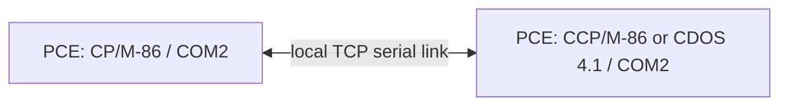

# MODEM9

MODEM 9.01 IBM-1.1, a CP/M-86 terminal and XMODEM-CRC transfer program.
Originally MODEM7 by Irvin M. Hoff; CP/M-86 conversion by Michael Mellinger
and Bill Bolton; IBM PC/XT adaptation by Dick Hill.

## Build

```
make
```

Requires the existing `cpm86_asm86`, `cpm86_gencmd` and `pcdev_cmdinfo`.
The original 8080-model CMD layout is retained. `make test` is intentionally
empty: PCE integration testing is a separate manual command.

## Use

Connect two machines through a null-modem serial link. The supplied build
uses **COM2, 2400 baud, 8 data bits, no parity, 1 stop bit**. Do not share
that UART with another program or OS console. The source has an 8 MHz
CPU timing constant; timeouts are CPU-dependent.

Start `MODEM9` on both machines. At `COMMAND (H for Help):`:

| Command | Action |
|---|---|
| `R FILE.BIN` | Receive into FILE.BIN; issue this first |
| `S FILE.BIN` | Send FILE.BIN from the other machine |
| `T` | Enter terminal mode; Ctrl-E returns to commands |
| `SET` | Configure baud rate and line parameters |
| `H` | Help |
| `CPM` | Exit to the OS |

Both ends must agree on line parameters. XMODEM transfers 128-byte records;
exact logical lengths within the final record are not preserved. Back up
existing destination files before receiving. See [the original manual](modem9.doc)
for additional commands and the original limitations.

## PCE testing

Run from this directory, outside make:

```
python3 testpce.py --work-dir /tmp/modem9-cpm-ccpm
python3 testpce.py --peer cdos41 --work-dir /tmp/modem9-cpm-cdos
```

Each work directory must be new. The script copies boot and data images,
loads the current `modem9.cmd`, and retains monitor, screen and serial logs.
It uses the sibling hacking project's CDOS 4.1 image/configuration for that
variant. Original boot images are not modified.



Validated on 2026-11-16 with the unmodified historical source:

| Pair | Result |
|---|---|
| CP/M-86 1.1 → CCP/M-86 3.1 | Pass |
| CCP/M-86 3.1 → CP/M-86 1.1 | Pass |
| CP/M-86 1.1 → Concurrent DOS 4.1 | Pass |
| Concurrent DOS 4.1 → CP/M-86 1.1 | Pass |

Each transfer sent 1,024 bytes containing every byte value (reverse order
for the return direction). After clean program exit and PCE shutdown,
received files were extracted from the private disks and compared exactly.
Tests used an 8088 PCE configuration at speed 1, COM2/8250, 2400 baud,
8N1, CRC, and `multichar=1`. Boot and command readiness are checked before
input is sent. Both machines advance in bounded alternating instruction
intervals. The script records the tested CMD's SHA-256.

The tested CMD SHA-256 is
`6966b1ee7b6450f18115df8d913885fc1b52da6cdda0cca88d9aa3c8ef0fcb60`.

These are basic transfer checks, not hardware or universal OS certification.
Other CDOS versions, baud rates, large-file/sequence-wrap transfers,
cancellation and injected transmission failures remain untested. The
historical source records receive-speed limitations; CPU-dependent timeout
loops are unchanged.

## License

The source retains its historical authorship and copyright notices,
including a Carpenter Associates notice in the embedded directory code.
No comprehensive redistribution/modification grant accompanies this copy;
the repository's default license does not replace those notices.
